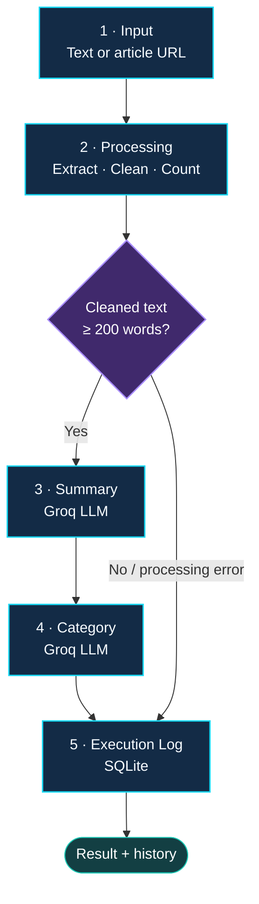
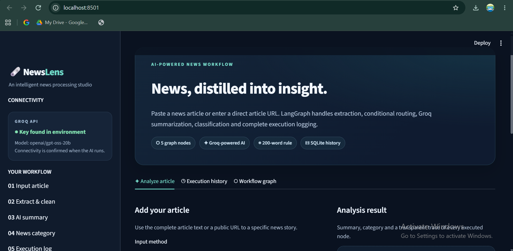
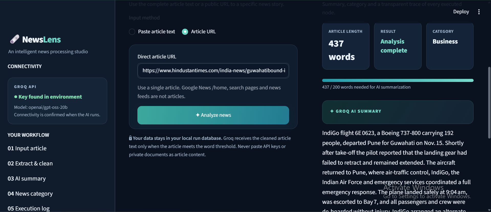

<div align="center">


# NewsLens 2.0 — AI News Summarizer

### Understand more. Read less.

An intelligent **news summarization and classification dashboard** that transforms article text or public article URLs into concise insights through a **five-node LangGraph workflow**, powered by **Groq**.

[](https://www.python.org/)
[](https://www.langchain.com/langgraph)
[](https://groq.com/)
[](https://streamlit.io/)
[](https://www.sqlite.org/)

**[Features](#-features) • [How it works](#-langgraph-workflow) • [Get started](#-quick-start) • [Project structure](#-project-structure) • [Testing](#-testing)**

</div>

---

## ✨ Overview

NewsLens is a Python/Streamlit application designed to help users understand long news articles without reading every paragraph. It accepts pasted article text or an article URL, extracts and cleans the content, checks its length, and—when enough readable content is available—uses Groq to summarize and categorize it. Every attempt is recorded locally for review.

> **Key behavior:** Articles with **200 or more cleaned words** enter the Groq summarization pipeline. Inputs with **fewer than 200 words**, and processing failures, go directly to execution logging. The threshold check is a conditional edge, **not a sixth node**.

## 🚀 Features

| Capability | Description |
|:--|:--|
| 📰 **Dual input** | Paste article text or submit a public article URL |
| 🧹 **Content processing** | Extract, clean, and count readable article words |
| 🧠 **AI summaries** | Generate concise summaries through Groq for eligible inputs |
| 🏷️ **Topic classification** | Assign a category such as Technology, Business, Sports, World, and more |
| 🔀 **Conditional routing** | Bypass the Groq calls when cleaned content has fewer than 200 words |
| 🗂️ **Execution history** | Save run results and node-by-node events in a local SQLite database |
| 🔎 **History dashboard** | Inspect previous runs and use the app's history/search/filter tools |
| 🌙 **Streamlit interface** | Responsive dark-themed dashboard with workflow and status views |
| 🧪 **Automated tests** | Tests for workflow branching, fetching, and local storage |

## 🧩 LangGraph workflow

The application has **exactly five LangGraph nodes** and a conditional route after processing.



**Node responsibilities**

1. **Input** — validates news text or a URL.
2. **Processing** — obtains article text, cleans content, counts words, and determines routing.
3. **Summary** — requests a factual, concise news summary from Groq.
4. **Category** — assigns one supported news category from Groq output.
5. **Execution log** — saves the run state and node events to SQLite, including skipped/error runs.

**Example:** A cleaned article with **199 words** is logged without an LLM call; **200 words** is eligible for the Groq summary and classification nodes.

## 🛠️ Tech stack

- **Frontend:** Streamlit with a custom dark theme
- **Language:** Python 3.11+
- **Workflow:** LangGraph
- **LLM integration:** LangChain Groq / Groq API
- **Article extraction:** Requests, Beautiful Soup, and Trafilatura
- **Persistence:** SQLite
- **Configuration:** `python-dotenv` and local `.env`

## ⚡ Quick start

### Prerequisites

- Python **3.11 or newer**
- A Groq API key from [Groq Console](https://console.groq.com/keys)
- Internet access for Groq requests and fetching online articles

### 1. Clone the repository

```powershell
git clone https://github.com/Madhav-pareek27/NewsLens-AI-News-Summarizer.git
cd NewsLens-AI-News-Summarizer
```

If you already have the project locally, **open the directory containing `app.py` and `requirements.txt`** and skip cloning.

### 2. Create a virtual environment (Windows PowerShell)

```powershell
py -m venv .venv
.\.venv\Scripts\Activate.ps1
python -m pip install -r requirements.txt
```

### 3. Set up your Groq key

```powershell
Copy-Item .env.example .env
```

Open the newly created **`.env`** file and enter your *own* Groq key:

```dotenv
GROQ_API_KEY=replace_with_your_own_key
GROQ_MODEL=openai/gpt-oss-20b
```

> **Security:** `.env` is private and must **never** be pushed to GitHub. The committed `.env.example` contains placeholders only. The model identifier may need adjustment if model availability changes; consult the Groq console for a model available to your account.

### 4. Start NewsLens

```powershell
python -m streamlit run app.py
```

Open **http://localhost:8501** in your browser.

**PowerShell blocks activation?** You can run without activating the environment:

```powershell
.\.venv\Scripts\python.exe -m pip install -r requirements.txt
.\.venv\Scripts\python.exe -m streamlit run app.py
```

<details>
<summary><b>macOS / Linux setup</b></summary>

```bash
python3 -m venv .venv
source .venv/bin/activate
python -m pip install -r requirements.txt
cp .env.example .env
# Open .env and set GROQ_API_KEY
python -m streamlit run app.py
```

</details>

## 🖥️ Application preview

The Streamlit application includes an **Analyze** view, a **Workflow** view, and an **Execution History** view.

<!-- To add genuine screenshots later, create assets/screenshots and then remove the
     HTML comment wrapper around the following two lines:




Do not commit a fake or empty screenshot. -->

**Want to show the UI here?** Run the app, take a screenshot of the main dashboard and an actual completed summary, save them as `assets/screenshots/dashboard.png` and `assets/screenshots/summary-result.png`, then uncomment the lines above.

## 📁 Project structure

```text
NewsLens-AI-News-Summarizer/
├── .streamlit/
│   └── config.toml          # Streamlit theme
├── assets/
│   └── newslens-banner.png # README hero image
├── data/                    # Local SQLite history (do not commit personal data)
├── tests/                   # Workflow, fetcher and storage tests
├── .env.example             # Safe API-key template
├── .gitignore               # Excludes secrets and generated files
├── app.py                   # Streamlit interface
├── news_fetcher.py          # URL ingestion and article extraction
├── workflow.py              # Five-node LangGraph agent
├── storage.py               # SQLite persistence
├── requirements.txt         # Dependencies
└── README.md                # Project guide
```

The real `.env` and `.venv` should exist **only on your local machine**, not in the public repository.

## 🧪 Testing

Run tests locally without a live Groq request for the mocked cases:

```powershell
python -m pip install pytest
python -m pytest -q
```

The test suite covers workflow branching, public URL handling, and SQLite behavior. For a full end-to-end Groq check, enter a valid API key and analyze a supported article of at least 200 cleaned words.

## 💡 How to use

1. Start the Streamlit dashboard.
2. Choose **text** or **URL** input.
3. Paste news content or an individual public article link.
4. Start the analysis.
5. Review the word count, AI-generated summary, classification, and execution trace.
6. Revisit saved runs in the **Execution History** view.

**Note:** A news homepage, search page, or paywalled / JavaScript-heavy URL may not provide extractable article text. When this happens, paste the article text directly.

## 🔐 Privacy and limitations

- **Groq is a cloud API**, so eligible article text is sent to Groq for processing. This is **not** a fully offline app.
- Your **Groq API key** belongs in `.env`, not in source code or the public repository.
- The SQLite execution log can store the original article text, source URL, summaries, model details, status, and error events. Do not publish databases containing personal or confidential content.
- The project summarizes **provided material**; it does not independently fact-check, verify sources, or guarantee that an article is accurate.
- Articles with fewer than 200 cleaned words are logged but not summarized. Very long inputs above the configured limit are rejected.
- Run tests and review dependency/security updates before deploying the application publicly.

## 🧯 Troubleshooting

| Issue | What to check |
|:--|:--|
| Groq key missing | Verify `.env` exists beside `app.py` and contains `GROQ_API_KEY` |
| No AI summary | Ensure the cleaned article has **at least 200 words** |
| URL extraction fails | Try an individual article URL or paste the article text |
| PowerShell activation error | Use the direct `.venv\Scripts\python.exe` commands above |
| Wrong model / unavailable model | Update `GROQ_MODEL` to a supported model identifier |
| Data from old runs | Local run history is stored in SQLite and can persist between sessions |

## 👨‍💻 Project

Built as a hands-on project exploring **agent orchestration, conditional routing, LLM integration, web content processing, and explainable execution traces**.

<div align="center">

**Built with Python · LangGraph · Streamlit · Groq**

[GitHub repository](https://github.com/Madhav-pareek27/NewsLens-AI-News-Summarizer)

</div>
