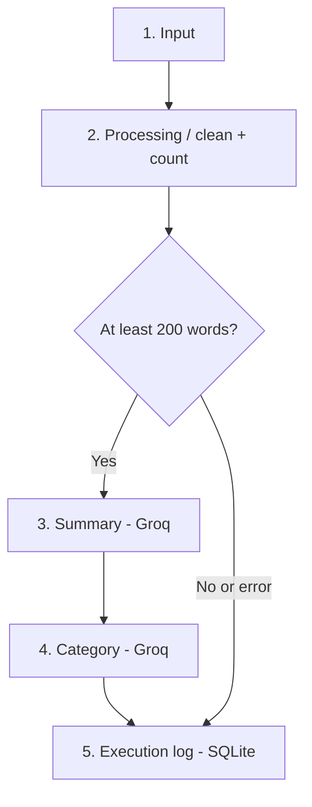

# NewsLens 2.0 — News Summarizer Agent

**Updated professional dashboard** with responsive dark UI, clear non-truncated status cards, a visual word threshold, execution traces, searchable/filterable history, and robust handling of Google News home/search URLs.

Important: the Google News homepage (`https://news.google.com/home?...`) is **not a news article**. Choose an individual story URL or paste the actual article text. A legitimate article under 200 words is still logged directly without calling Groq.

A Streamlit app that accepts **news text or a public URL**, cleans/extracts content, routes **fewer than 200 words directly to execution logging**, and otherwise calls **Groq** to summarize and classify the article. Every run is saved to a **local SQLite database**.

## Workflow (exactly 5 nodes)



The diamond is **a conditional edge, not a sixth LangGraph node**. Exactly 200 words goes to summary; 199 words goes to the log.

## Run on Windows (PowerShell)

Requirements: Python **3.11+**, internet for live news URLs and the Groq API.

```powershell
# Only use cd news_summarizer_agent if your prompt is in the parent folder.
# If your terminal already ends in \news_summarizer_agent>, skip the cd command.
py -m venv .venv
.venv\Scripts\Activate.ps1
python -m pip install -r requirements.txt
Copy-Item .env.example .env
```

Open `.env` in Notepad or VS Code. Replace `your_groq_api_key_here` with your Groq API key from <https://console.groq.com/keys>. Do not include quotes and **never paste your key into GitHub or share it**.

```powershell
streamlit run app.py
```

The local app normally opens at <http://localhost:8501>.

**PowerShell activation blocked?** Instead of activating, run:

```powershell
.venv\Scripts\python.exe -m pip install -r requirements.txt
.venv\Scripts\python.exe -m streamlit run app.py
```

## Run on macOS/Linux

```bash
cd news_summarizer_agent
python3 -m venv .venv
source .venv/bin/activate
python -m pip install -r requirements.txt
cp .env.example .env
# Edit .env and insert GROQ_API_KEY
streamlit run app.py
```

## Files

- `app.py` — updated Streamlit UI (Analyze, Execution history, Workflow tabs).
- `.streamlit/config.toml` — dark teal Streamlit theme.
- `workflow.py` — five LangGraph nodes, Groq calls, branching and orchestration.
- `news_fetcher.py` — safe-ish public URL validation, article extraction, text cleaning.
- `storage.py` — persistent SQLite run records.
- `tests/test_workflow.py` — mocked graph tests; no live API key necessary.
- `tests/test_fetcher.py` — Google News home/search URL guard and cleaning tests.
- `tests/test_storage.py` — local SQLite aggregation and run history tests.
- `.env.example` — environment variables (copy to `.env`).
- `data/news_runs.db` — local history file, created on first run.

## Persisted data

Each record stores `run_id`, UTC time, input type, source URL, original content, cleaned content, word count, summary, category, status, errors, model ID and node-by-node events. API keys are **not persisted**. The History tab can inspect and export complete runs. Treat the database as sensitive if you paste confidential information.

## Sample tests

```bash
python -m pip install pytest
python -m pytest -q
```

The mocked test cases cover **199 words**, **200 words**, URL ingestion and input errors. Live Groq integration requires an API key and network access.

## Operational notes

- The default model `openai/gpt-oss-20b` is supported on Groq's developer tier. Set `GROQ_MODEL` to a supported model ID from the Groq model catalog if you wish to change it.
- Some websites are paywalled or render their content only in JavaScript. For these sites, paste the article text.
- News URL fetching refuses local/private IPs, limits redirects/download size and enforces HTTP(S); production deployments should **also** use network-level egress filtering to mitigate DNS rebinding and similar SSRF risks.
- This is a deterministic five-node **agent workflow** (fixed actions with conditional routing), not an autonomous tool-using research agent. It only summarizes what it receives and cannot independently verify claims in the news.
- This educational implementation handles a single article per invocation. Extremely long articles over 60,000 characters are rejected rather than silently truncated.

## Updating an existing installation

If NewsLens is already running, press **Ctrl+C** in the VS Code terminal.
Back up your `.env` and `data/news_runs.db`, then replace `app.py`, `workflow.py`,
`news_fetcher.py`, `storage.py` and add `.streamlit/config.toml` (or extract the ZIP
into a new folder). **Do not overwrite your existing `.env` or SQLite database.**

Check that `.env` contains **only a real model ID** on the `GROQ_MODEL` line:

```env
GROQ_API_KEY=your_actual_key
GROQ_MODEL=openai/gpt-oss-20b
```

Python/debug code in the old sidebar was likely caused by an incorrect
`GROQ_MODEL` value being displayed in a code widget. The updated app validates
model names and uses the default when malformed.

Run from the folder containing `app.py` and `requirements.txt`:

```powershell
python -m pip install -r requirements.txt
python -m streamlit run app.py
```

Refresh `http://localhost:8501` (Ctrl+Shift+R).

### Troubleshooting
- The Groq status **Key found** means the env variable exists; the API connection
  is only confirmed when a 200+ word article calls Groq.
- The article must contain 200+ **cleaned** words for summarization; shorter
  articles are intentionally logged and skipped.
- Some news sites have paywalls, bot protection, or JavaScript-rendered pages.
  Paste article text when extraction fails.
